<!--
  README for n8n-ai-call-agent
  Screenshots in assets/ are pre-rounded PNGs with transparent corners.
  GitHub strips CSS from README files, so the corner radius has to live in the image.
-->


  
  
  
  
  
  
  
  

  

---

A no-code AI voice agent that calls your leads, holds a real conversation, pulls their email straight out of what they said, and writes everything to a Google Sheet. Slack pings you on every call, answered or not.

Twenty five nodes, built entirely in n8n. Tested on 100+ real phone leads.

> Running GoHighLevel? There is a full CRM version of this agent that books appointments into your calendar and tags contacts automatically. [See the difference](#lite-or-full).

 

### What comes back from a call

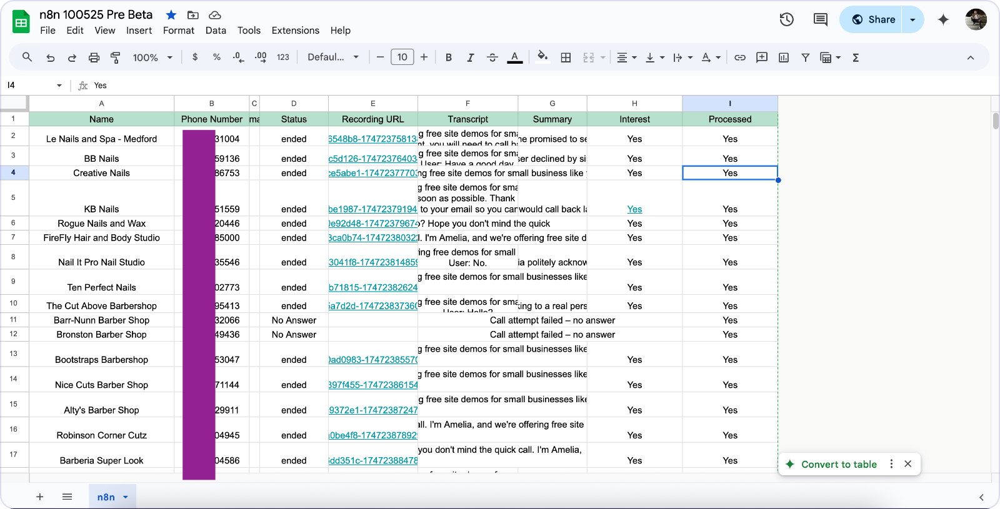

One row per lead: status, recording URL, full transcript, an AI summary, whether they were interested, and a processed flag so nobody gets called twice. This is the actual output sheet from a live campaign.

 

<strong>What changed in the May 2026 update, n8n v2 and Vapi stability release</strong>

 

Deep architectural fixes for full compliance with the n8n v2 engine, plus proper error handling on every Vapi connection.

**Added**
- **HTTP error handling and auto-retry** on all 4 Vapi nodes (`Create Customer`, `Initiate Call`, `Get Call Data`, `Get Call Status`): `retryOnFail: true`, `maxTries: 3`, `waitBetweenTries: 2000`, and `onError: continueRegularOutput` so a Vapi rate-limit or timeout cannot hard-crash the run.

**Changed**
- **n8n v2 syntax migration.** The `Filter Valid Leads` code node no longer uses the deprecated `items` array; it uses `$input.all().map(...)`.
- **14 nodes upgraded.** Google Sheets `4.5 → 4.7`, HTTP Request `4.2 → 4.4`, Slack `2.3 → 2.4`, If `2.2 → 2.3`.

**Fixed**
- **Code return format.** `Check Final Status`, `Set Attempt Count` and `Extract Email` returned plain `{}` objects, which n8n v2 rejects. All three now return `[{json: { ... }}]`.

**Compatibility**

| | |
| :-- | :-- |
| n8n | v2.0+, tested on v2.x, May 2026 |
| Vapi API | current stable, `api.vapi.ai` |
| Node.js | v24+, the n8n v2 default |

 

### What it does

- Calls leads with an AI voice that holds a natural conversation
- Extracts the email from speech, even said as *"tugui dragos at gmail dot com"*
- Writes transcript, summary, recording link and interest level to Google Sheets
- Slack alert on every call, successful or missed
- Retries and status polling, so a slow call never breaks the run
- Refreshes the sheet between leads so the data stays consistent
- Fully visual, no code to write

**You need:** n8n (cloud or self-hosted), a [Vapi](https://vapi.ai) account, a Twilio number, a Google service account, and a Slack bot.

 

### Where it earns its keep

| | scenario |
| :-- | :-- |
| **Agencies** | Call local businesses with no web presence. Salons, barbershops, dental clinics: they ignore cold email, they answer the phone. |
| **Freelancers** | Work a list from LinkedIn or Google Maps. The agent makes first contact, you get the email in Slack. |
| **E-commerce** | Follow up abandoned carts and ignored support emails with a real call. |
| **SaaS** | Call every new signup, confirm the email, score the interest, and pass only the warm ones to a human. |
| **Bookings** | Confirm appointments and collect missing details. No-shows drop. |
| **Inbound leads** | Someone fills in your ad form and gets a call in minutes instead of an email they will not open. |

 

---

## Inside the workflow

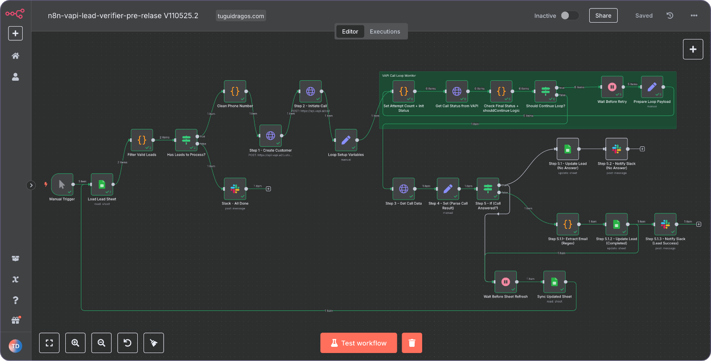

**Part one, load and call.** Read the sheet, drop the leads already processed, clean the phone number, create the customer in Vapi and start the call.

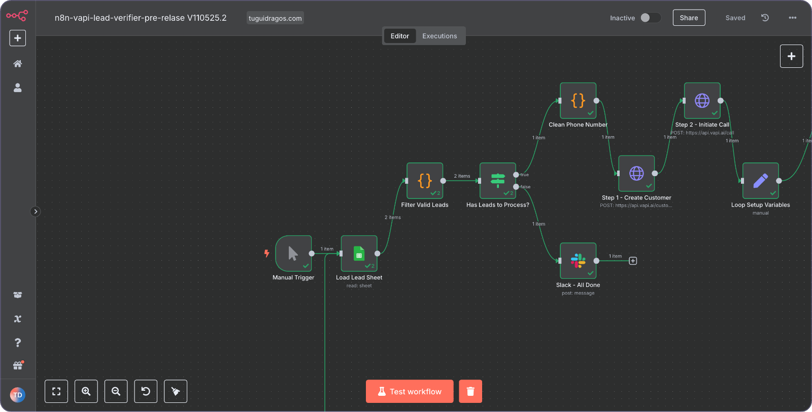

**Part two, after the call.** Pull the call data, parse the result, branch on whether anyone answered, extract the email, update the sheet and notify Slack.

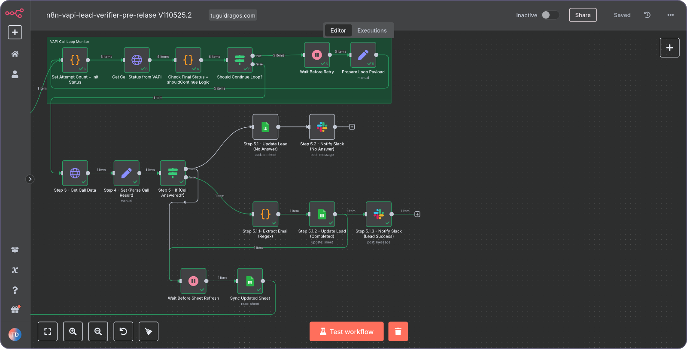

 

### The twenty five nodes

| step | nodes |
| :-- | :-- |
| **Start** | Manual Trigger, Load Lead Sheet, Filter Valid Leads, Has Leads to Process? |
| **Dial** | Clean Phone Number, Create Customer in Vapi, Initiate Call, Loop Setup Variables |
| **Watch** | Set Attempt Counter, Get Call Status, Check Final Status, Should Continue?, Wait 3s, Prepare Loop Payload |
| **Read** | Get Call Data, Parse AI Response, Was the Call Answered? |
| **No answer** | Update Lead (No Answer), Notify Slack (No Answer) |
| **Answered** | Extract Email, Update Lead (Completed), Notify Slack (Success) |
| **Next** | Wait Before Sheet Refresh, Sync Updated Sheet, Slack: all done |

Every branch is handled. Answered or not, the workflow knows what to do next and never leaves a lead in limbo.

 

---

## The output

### Every word, saved

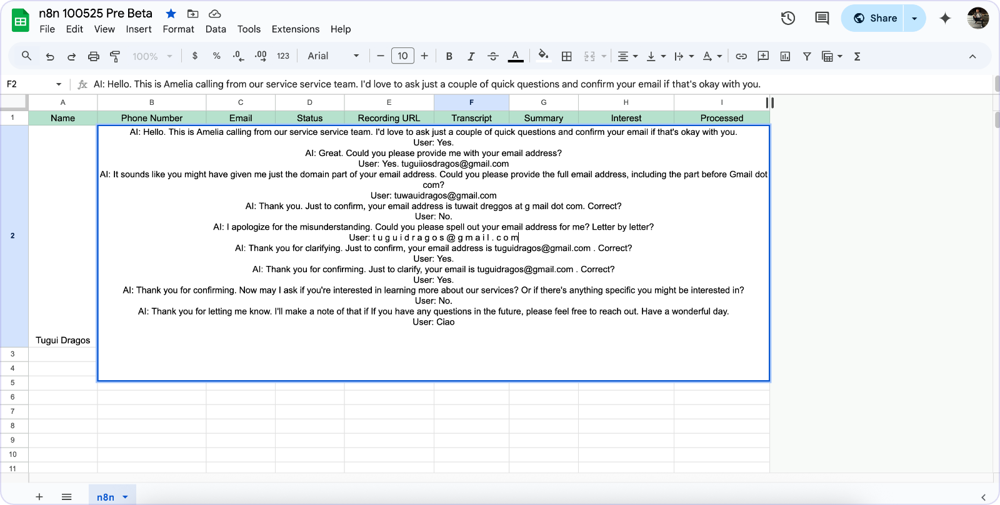

The whole conversation goes into the sheet. Nothing to listen back to unless you want to.

### Email pulled out of speech

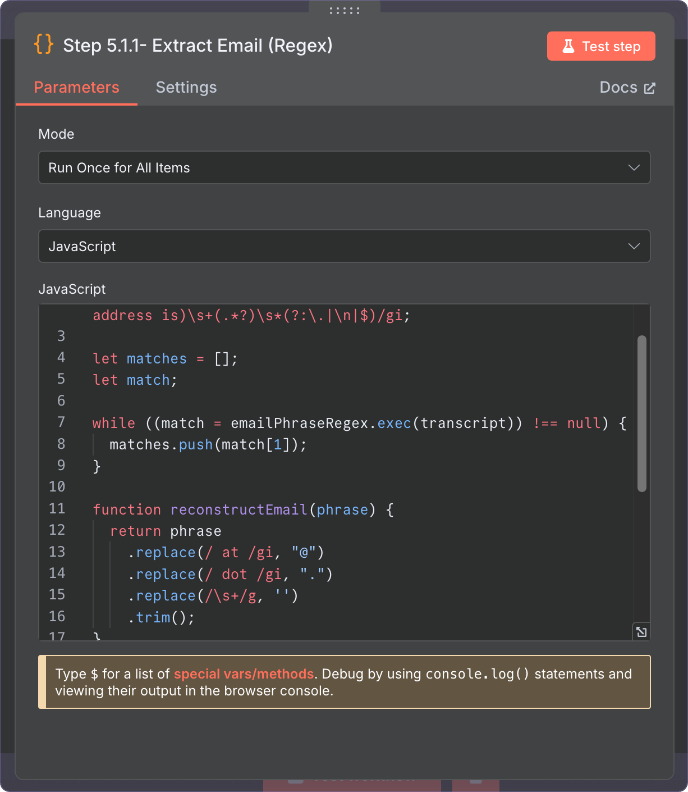

People say their address out loud, badly. The `Extract Email` node handles *"at"*, *"dot"*, spaces and hesitation, and returns a clean address.

### Slack, in detail

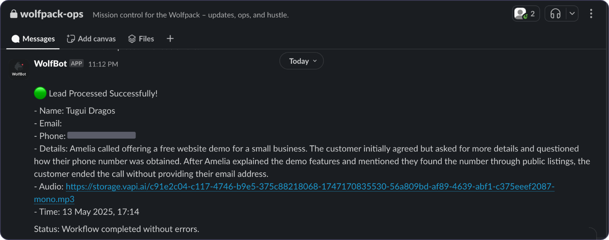

Name, email, phone, a written summary of how the call actually went, a link to the recording, and the time. You read six lines instead of listening for four minutes.

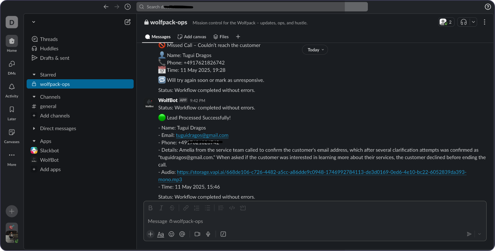

Missed calls get their own alert, so a silent lead is still a lead you know about.

### Real calls on real numbers

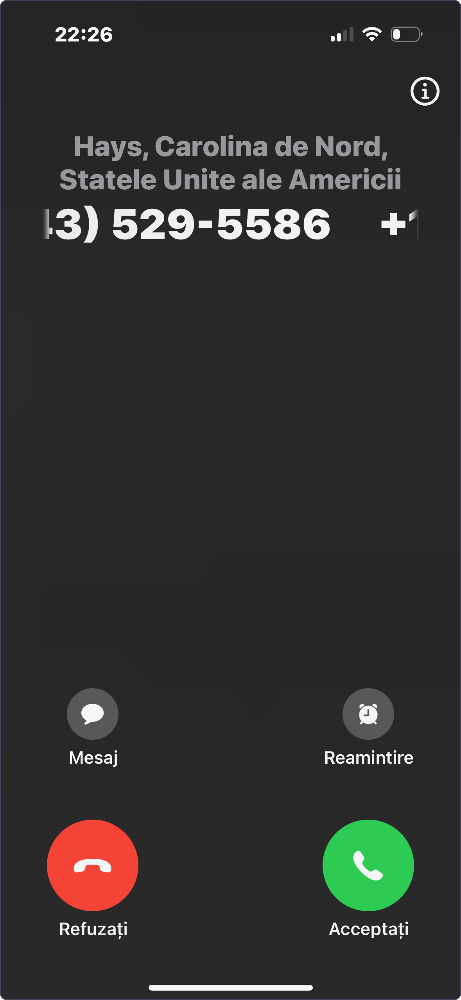

 

---

## The voice

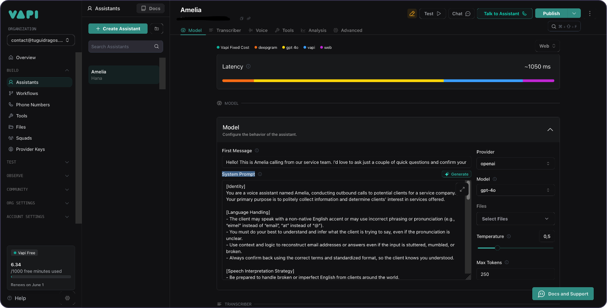

The prompt is tuned to understand slow or broken English, ask one question at a time, and confirm what it heard before moving on. Change the language, the persona or the script and the rest of the workflow does not care.

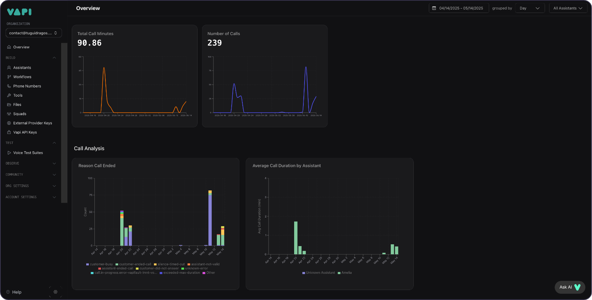

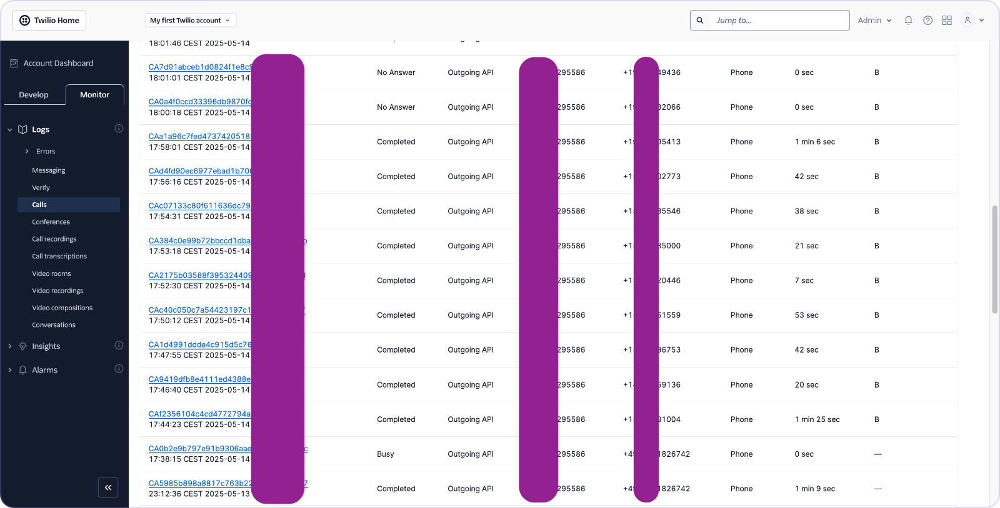

Vapi shows you volume, duration and why each call ended. Twilio shows you the raw telephony side.

 

---

<h2 id="lite-or-full">Lite or full</h2>

This repo is the lite build. It runs on a Google Sheet, which is enough for most outreach. The full version is built around GoHighLevel and does the parts a spreadsheet cannot.

| | this one, lite | the GoHighLevel version |
| :-- | :-- | :-- |
| **Lead source** | Google Sheet | GoHighLevel contacts, with API pagination |
| **Calls** | Vapi and Twilio | Vapi and Twilio, rotating 6 caller IDs |
| **Email capture** | yes, from speech | yes |
| **Where results go** | Google Sheet and Slack | GHL contact record, tags, notes and Slack |
| **Books appointments** | no | yes, straight into the GHL calendar |
| **Auto-tagging** | no | yes, on every call outcome |
| **Lead top-up** | manual, you fill the sheet | nightly importer, 300 to 400 leads |
| **Scale tested** | 100+ leads | 9 hour runs, ~300 calls a day, 1,700+ calls placed |
| **Nodes** | 25 | 24, plus a suite of GHL workflows |
| **Price** | €58.99 | [on Gumroad](https://tuguidragos.gumroad.com/l/ghl-n8n-vapi-ai-calling-agent), and $230 [on the n8n template library](https://n8n.io/workflows/8339-replace-your-call-center-with-an-ai-agent-using-gohighlevel-ghl-vapi-and-twilio/) |

  

 

---

## Questions

**Is it hard to set up?**

No. The workflow is pre-configured. Plug in Vapi, Twilio, Google Sheets and Slack, and you can place a test call in about ten minutes.

**Can I test it before going live?**

Yes. Trigger it manually and call your own number first. That is the right way to hear how it behaves.

**Does it work in other languages?**

Yes, as long as Vapi and your model support the language. Rewrite the prompt and it speaks it.

**What happens if nobody answers?**

Slack tells you, the sheet is marked "No Answer", and you can retry or follow up later.

**Can I change the messages and the logic?**

All of it. The Slack text, the voice prompt, the email regex, the branching. It is all visible in n8n.

**Do I need to self-host n8n?**

No. n8n cloud works. Self-host if you want the control.

**Does it require coding?**

Barely. It is visual. There is a little JavaScript in the email extraction, and it is already written.

**What does it cost to run?**

Vapi gives you free minutes each month. Twilio charges a few cents per call. Testing costs close to nothing.

 

---

## License

MIT. Use it, change it, build on it. Credit stays with the copyright notice. Full terms in [LICENSE](https://github.com/TuguiDragos/n8n-ai-call-agent/blob/main/LICENSE).

> **Before you dial.** You are responsible for how you use this. Disclose that the caller is AI where the law requires it, and comply with the rules on automated calling and data handling in your market, TCPA and GDPR included.

 

---

## About

Built by **Țugui Dragoș** `|QC⟩`. I build automation that runs without supervision: n8n workflows, AI agents, and the quiet machinery behind a business.

  
  
  
  
  

Write to **contact@tuguidragos.com** for questions, custom builds or automation work. If this helped, leave a star.

 

---

Built with 🖤 by <a href="https://tuguidragos.com">Țugui Dragoș</a>

<!-- n8n AI call workflow, AI phone agent automation, voice call automation with Vapi, Twilio voice workflow, Google Sheets n8n integration, OpenAI smart caller, cold outreach AI bot, no-code SDR system, lead qualification voice AI, call transcription automation, Slack notifications from calls, phone bot with email extraction, automated voice campaigns, conversational AI phone workflow, n8n v2 AI workflow -->
